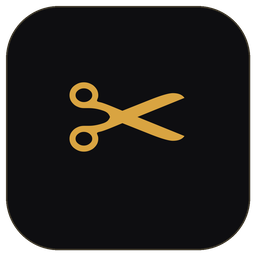
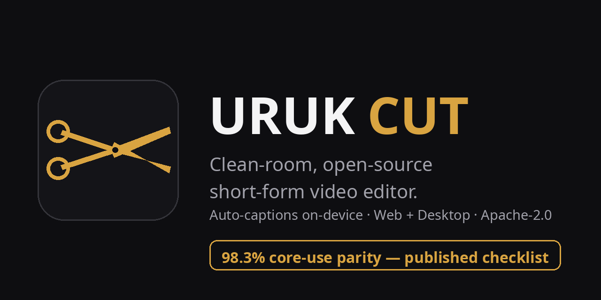
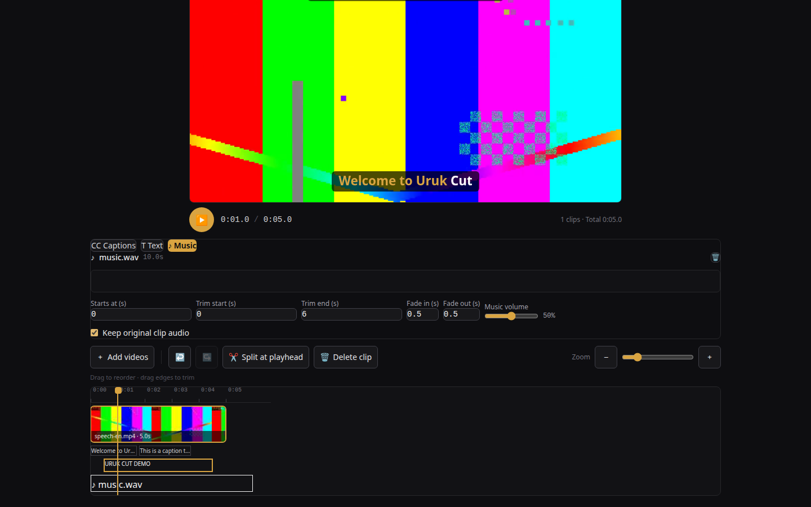
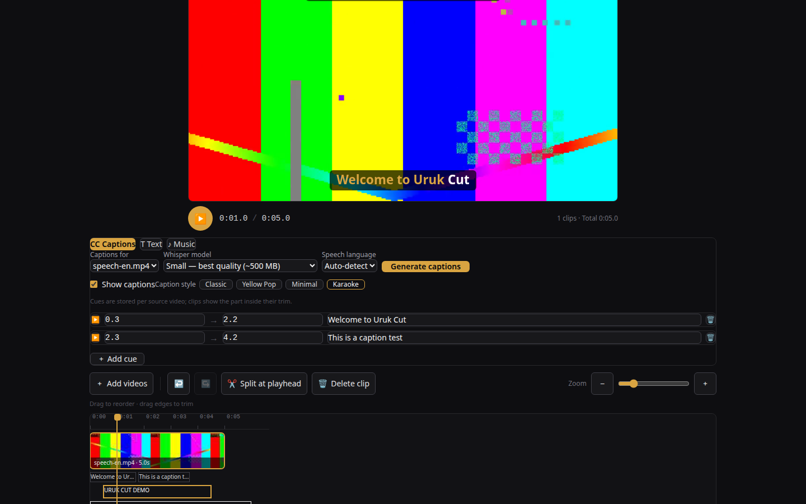
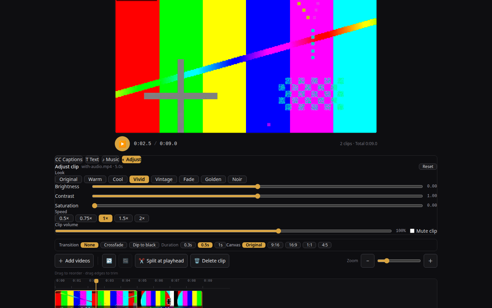
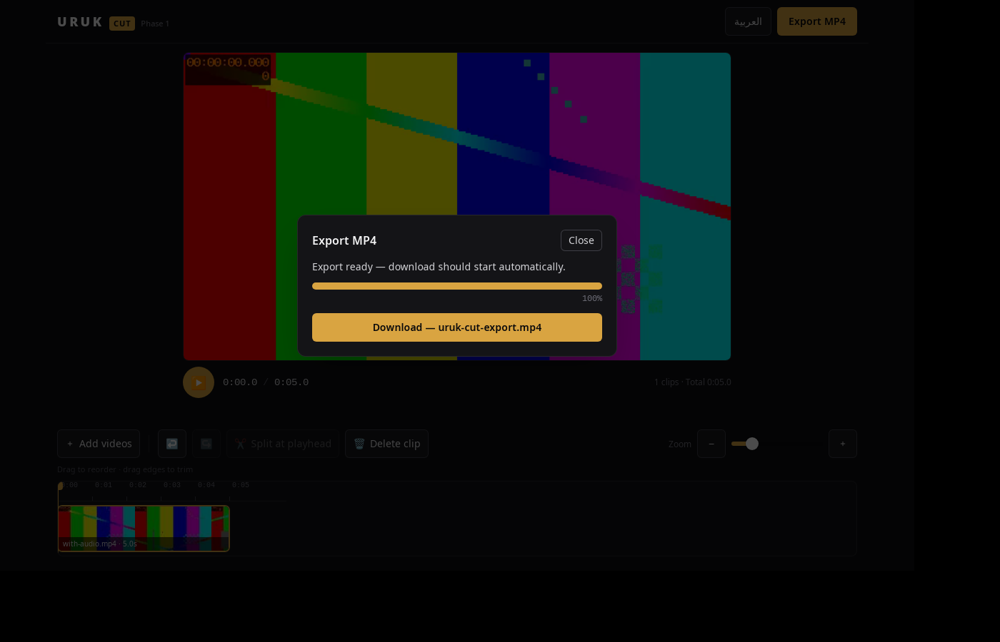

<div align="center">



# URUK CUT

**A clean-room, open-source short-form video editor — in your browser and on your desktop.**

محرّر فيديو قصير مفتوح المصدر، مبني من الصفر — يعمل بالكامل على جهازك، بدون رفع ملفات وبدون حسابات.

<br/>

[](https://github.com/dolanexeee/uruk-cut/releases)
[](https://github.com/dolanexeee/uruk-cut/actions/workflows/release-desktop.yml)
[](./PARITY.md)
[](./LICENSE)
[](#-download)



<br/>

[**▶ Use it in your browser**](https://uruk-cut.vercel.app) · [**⬇ Download the desktop app**](https://github.com/dolanexeee/uruk-cut/releases/latest) · [**✔ Parity checklist**](./PARITY.md) · [**🛠 Build from source**](#-build-from-source)

</div>

---

## What is Uruk Cut?

Uruk Cut edits short-form video the way it should be edited: **locally**. Import clips, arrange them on a timeline, trim, split, caption, style, and export a finished MP4 — every step runs on your own machine. No uploads, no render queues, no accounts, no watermarks.

It is the first application in the **URUK** open-source suite, and it exists in two forms from **one codebase**:

| | Web app | Desktop app |
|---|---|---|
| **Runs on** | Any modern browser | Windows, macOS, Linux |
| **Export engine** | FFmpeg compiled to WebAssembly | Bundled **native FFmpeg** sidecar |
| **Install** | None — [open the site](https://uruk-cut.vercel.app) | [.msi / .exe · .dmg · .deb / .rpm / AppImage](#-download) |
| **Your media** | Never leaves the tab | Never leaves the machine |

---

## ⬇ Download

| Platform | Get it |
|---|---|
| **Web** | **[uruk-cut.vercel.app](https://uruk-cut.vercel.app)** — nothing to install |
| **Windows** | `.msi` / `.exe` from the [latest release](https://github.com/dolanexeee/uruk-cut/releases/latest) |
| **macOS** | `.dmg` (Apple Silicon + Intel) from the [latest release](https://github.com/dolanexeee/uruk-cut/releases/latest) |
| **Linux** | `.deb` · `.rpm` · `.AppImage` from the [latest release](https://github.com/dolanexeee/uruk-cut/releases/latest) |

Desktop installers for Windows and macOS are built by this repository's own CI on every `v*` tag; the Linux installers in the v0.1.0 release were built and verified locally.

---

## ✨ Highlights

<table>
<tr>
<td width="50%" valign="top">

<br/><b>Timeline editing</b> — multi-clip timeline with filmstrips, drag trims, split at playhead, reorder, and full undo/redo.
</td>
<td width="50%" valign="top">

<br/><b>Auto-captions, on-device</b> — Whisper runs locally (Arabic + English), with karaoke highlighting and four caption styles. Nothing is sent to a server.
</td>
</tr>
<tr>
<td width="50%" valign="top">

<br/><b>Looks &amp; adjustments</b> — per-clip brightness / contrast / saturation, eight look presets, and per-clip speed from 0.5× to 2×.
</td>
<td width="50%" valign="top">

<br/><b>Native desktop export</b> — the Tauri build renders with a bundled native FFmpeg binary; the web build uses the same pipeline in WebAssembly.
</td>
</tr>
</table>

---

## Features

**Editing core**
- Multi-import (picker or drag & drop) with automatic filmstrip thumbnails
- Timeline with ruler, playhead, zoom — trim by dragging edges, split, delete, reorder
- Undo / redo across the whole timeline; sequence preview that honors every in/out point
- Transitions: crossfade and dip-to-black between clips
- Canvas presets for every platform — 16:9, **9:16**, 1:1, 4:5

**Captions & text**
- On-device speech-to-text (Whisper) in **Arabic and English**, burned into exports
- Karaoke word highlighting + four caption styles
- Text overlays with **animated entrances** (fade, slide-up, pop)

**Look & sound**
- Per-clip brightness / contrast / saturation + eight one-tap look presets
- Per-clip speed (0.5×–2×) and per-clip volume — both rendered into the export
- Music track mixed under the video audio

**Projects**
- Save / open full projects as portable `.urukcut` files
- Automatic recovery: your work-in-progress is restored after a reload

**Interface**
- English / Arabic with full RTL layout
- Mobile-first design (built and tested at phone sizes), desktop-grade on large screens

---

## ✔ Parity — measured, not claimed

"As good as the editor you're used to" is a slogan. Uruk Cut publishes its yardstick instead: **[PARITY.md](./PARITY.md)** defines the core-use surface of a short-form editor as **30 explicit items**, each scored Done (1) / Partial (0.5) / Missing (0), never rounded up, with the out-of-scope list (cloud AI effects, proprietary asset libraries, accounts) printed next to the score.

> **Current score: 98.3% — 29 Done · 1 Partial · 0 Missing.**

Every claim in that file is backed by an automated test or a measured export (durations, loudness in dB, pixel-diffs) in this repository's QA suite.

---

## How it works

```
                ┌──────────────────────────────────────────┐
                │     One UI — Next.js static export        │
                │     (timeline · captions · projects)      │
                └───────────────┬──────────────────────────┘
                                │
              ┌─────────────────┴─────────────────┐
              ▼                                   ▼
     Browser (web build)                 Tauri v2 (desktop build)
     FFmpeg → WebAssembly                Native FFmpeg sidecar
                                         (shipped as `uruk-ffmpeg`)
              └─────────────────┬─────────────────┘
                                ▼
        Same segment-cut + concat pipeline → one MP4 (H.264 + AAC)
        Captions: Whisper runs on-device (Web Worker / WASM)
```

- **State** — Zustand store; project files are self-contained ZIP archives (`.urukcut`, via fflate) with IndexedDB autosave.
- **Captions** — `@huggingface/transformers` runs Whisper in a Web Worker; caption timing, karaoke and styling are rendered into the export on both pipelines (ASS-exact on desktop and web).
- **Desktop detection** — the UI branches at runtime (`window.__TAURI_INTERNALS__`) between the WASM and native export paths; everything above the export layer is identical.

Full development history, deployment notes and per-phase QA evidence: **[docs/DEVELOPMENT.md](./docs/DEVELOPMENT.md)**.

---

## 🛠 Build from source

**Prerequisites:** Node.js 22+, npm. For the desktop app: Rust (stable) + your platform's [Tauri v2 prerequisites](https://tauri.app/start/prerequisites/).

**Web**

```bash
npm ci
npm run dev        # development server
npm run build      # static export into out/ (also copies the FFmpeg core)
npm run start      # serve out/ statically
```

**Desktop**

```bash
npm ci
bash scripts/fetch-sidecar.sh   # static FFmpeg -> src-tauri/binaries/
npm run tauri dev               # run the desktop shell against the dev server
npm run tauri build             # installers -> src-tauri/target/release/bundle/
```

Releases are cut by pushing a `v*` tag — the [release workflow](.github/workflows/release-desktop.yml) builds all four desktop targets and attaches the installers to the GitHub Release.

---

## Clean-room statement

Uruk Cut is a **clean-room implementation**. It was designed and written from public documentation (web platform APIs, the FFmpeg command-line interface) and from the observed behavior of general video-editing workflows. The concepts of a timeline, clips with in/out points, splitting and export are industry common practice. This repository contains **no third-party proprietary code, assets, artwork or branding**, and no commercial editor's code was read, decompiled or copied in its creation. All source code is original work, released under the Apache License 2.0.

*Uruk Cut is an independent open-source project. It is not affiliated with, endorsed by, or connected to CapCut or ByteDance; product names are mentioned only to describe the editing category and the parity yardstick.*

---

## Contributing

Issues and pull requests are welcome. Please run the QA suites before submitting (`qa/` in this repo) and keep the honesty rule that governs this project: **if PARITY.md can't claim it with evidence, the README doesn't claim it either.**

## License

Apache License 2.0 — see [LICENSE](./LICENSE). The desktop app bundles an unmodified static FFmpeg build as a standalone sidecar executable (GPLv3); the web build loads FFmpeg's WebAssembly core (GPL-2.0-or-later) from the app's own static assets.

---

<div align="center">

**URUK** — open-source apps from the first city of writing.
First app: **Uruk Cut** · Web: [uruk-cut.vercel.app](https://uruk-cut.vercel.app)

</div>
